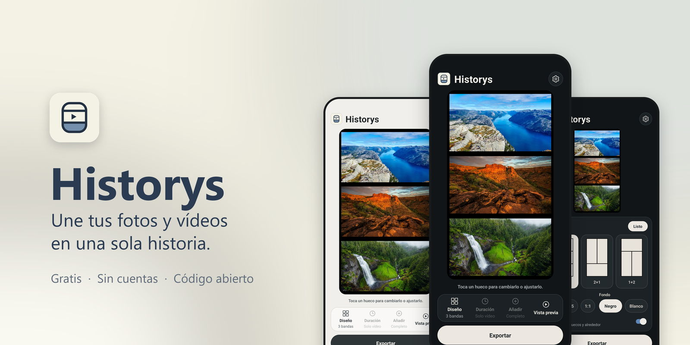
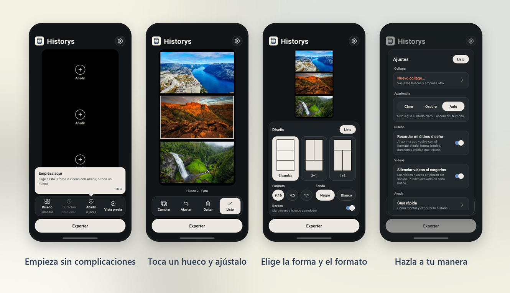

<div align="center">



<br />
<br />

**Une tus fotos y vídeos en una sola historia.**
<br />
Gratis, sin cuentas, sin anuncios y de código abierto.

<br />

[](https://github.com/chesterchasis/historys/releases/latest)

<br />


</div>

<br />

## Qué es

Historys te deja poner hasta tres fotos o vídeos en un mismo lienzo y guardar el resultado listo para compartir. Eliges la forma, ajustas el encuadre con los dedos y exportas. Lo que ves en pantalla es exactamente lo que sale en el archivo.

No necesita acceso de lectura a tu galería: las fotos se eligen con el selector del sistema y todo se procesa en tu móvil.

<br />

<div align="center">

</div>

<br />

## Lo que puedes hacer

- **Tres formas de collage.** `3 bandas`, `2+1` y `1+2`. Si cambias de forma, tus fotos se quedan donde estaban.
- **Tres formatos.** `9:16` para historias, `4:5` para el feed y `1:1` para cuadrado, con fondo blanco o negro y esquinas redondeadas.
- **Encuadre a tu gusto.** Zoom con los dedos, arrastre y doble toque. Lo que recortas en pantalla es lo que se exporta.
- **Vídeos con sonido o sin él.** Silencia cada clip por separado. Si hay varios con sonido, se mezclan en una sola pista.
- **Recorte de vídeo.** Elige con una barra qué parte de cada clip quieres usar.
- **Colores fieles.** Los vídeos HDR del móvil se convierten con cuidado para que no salgan lavados ni con demasiado brillo.
- **Calidad a tu medida.** `Ligera`, `Normal` o `Máxima`, con el peso aproximado antes de guardar.
- **Claro, oscuro o automático.** La app sigue el tema de tu teléfono si quieres.
- **Una guía suave al empezar.** Tres burbujas te enseñan por dónde ir y puedes repetirlas desde los ajustes.

Si solo usas fotos, la exportación sale como imagen JPG en doble resolución, sin convertirla en vídeo.

<br />

## Cómo se usa

1. **Elige la forma.** Toca `Diseño` y escoge formato, forma, fondo y bordes.
2. **Añade tus fotos y vídeos.** Toca un hueco, o usa `Añadir` para cargar varios de golpe.
3. **Ajusta cada hueco.** Mueve, haz zoom, recorta el vídeo o cambia el sonido. Mantén pulsado y arrastra para intercambiar dos huecos.
4. **Pon la duración.** Elige entre 5, 10, 15 o 30 segundos.
5. **Mira cómo queda y exporta.** La vista previa te enseña el resultado, y `Exportar` lo guarda en el álbum **Historys** de tu galería.

<br />

## Descarga

La última versión está en la página de **[Releases](https://github.com/chesterchasis/historys/releases/latest)**.

1. Descarga el archivo `.apk` en tu móvil Android.
2. Ábrelo y, si el teléfono te lo pide, permite instalar apps desde el navegador o el gestor de archivos.
3. Listo. Funciona en Android 7.0 o superior.

> El APK está firmado con una clave de pruebas. Si algún día la app llega a Google Play, habrá que desinstalar esta versión antes de instalar la de la tienda.

<br />

## Para quien quiera compilarla

Historys está hecha con [Expo](https://expo.dev) (SDK 54), React Native y TypeScript. El vídeo se renderiza con FFmpeg y, como lleva código nativo, **no funciona en Expo Go**: hay que compilarla.

Necesitas Node.js 18 o superior, Android Studio con el SDK de Android y JDK 17.

```bash
npm install
npm run prebuild:android     # genera la carpeta android/
npm run android              # compila e instala en el móvil conectado
```

Para generar un APK de distribución:

```bash
cd android
./gradlew assembleRelease    # en Windows: .\gradlew.bat assembleRelease
```

El APK queda en `android/app/build/outputs/apk/release/`. En [`docs/ANDROID_STUDIO.md`](docs/ANDROID_STUDIO.md) hay una guía paso a paso con Android Studio.

<details>
<summary><strong>Estructura del proyecto</strong></summary>

<br />

```text
historys/
├── App.tsx                  Pantalla principal
├── app.json                 Configuración de Expo y Android
├── plugins/                 Plugins de configuración nativa
├── src/
│   ├── components/          Lienzo, huecos, paneles, ajustes y burbujas de ayuda
│   ├── constants/           Formatos, duraciones y calidades
│   ├── theme/               Tema claro y oscuro
│   ├── types/               Tipos del collage
│   └── utils/               Geometría, exportación con FFmpeg, ajustes y recorte
└── docs/                    Guías, lista de pruebas y documentos de diseño
```

</details>

<br />

## Ayuda y mejoras

¿Has encontrado un fallo o tienes una idea? Abre un [issue](https://github.com/chesterchasis/historys/issues) y lo vemos. Las contribuciones son bienvenidas. La lista de comprobaciones en dispositivo está en [`docs/CHECKS.md`](docs/CHECKS.md).

<br />

## Licencia y créditos

Historys es software libre bajo la licencia **[GNU GPL v3](LICENSE)**: puedes usarla, estudiarla, modificarla y compartirla.

Usa [FFmpeg](https://ffmpeg.org) (a través de [ffmpeg-kit-react-native](https://github.com/wokcito/ffmpeg-kit-react-native)), que incluye componentes con licencia GPL. Gracias a todos los proyectos de código abierto que lo hacen posible.

<br />

<div align="center">

Hecho con cariño por **chesterchasis**

</div>
