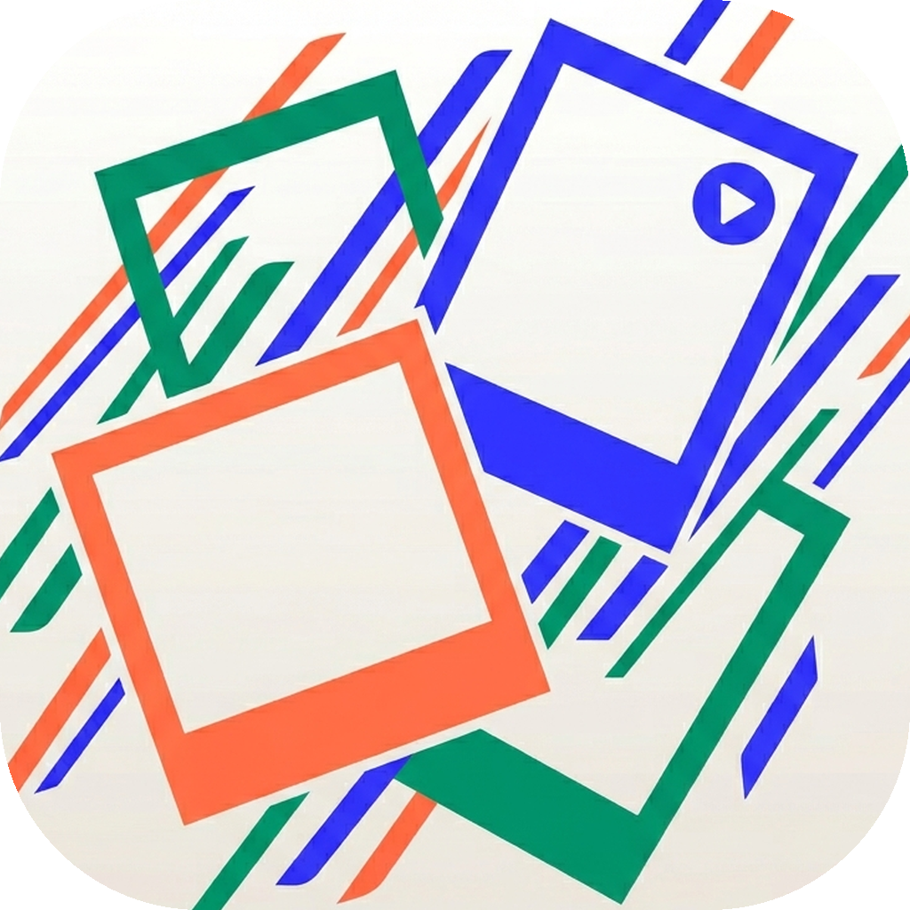

<div align="center">



# Historys

**Creador de collages 9:16 de fotos y vídeos en Full HD para Android e iOS**

[](package.json)
[](https://expo.dev)
[](https://reactnative.dev)
[](tsconfig.json)
[](src/utils/collageExport.ts)

</div>

---

**Historys** es una aplicación móvil desarrollada con **Expo (SDK 54)** y **React Native** que permite combinar fotos y vídeos en un único lienzo vertical **9:16 (`1080 × 1920`)**, pensado para **Instagram Stories, TikTok y WhatsApp Status**.

La interfaz, la vista previa a pantalla completa y el motor de renderizado en **FFmpeg** comparten exactamente la misma geometría de recorte: **lo que encuadras en pantalla es lo que sale en el archivo MP4**.

---

## Características principales

| Categoría | Detalle |
| :--- | :--- |
| **Lienzo 9:16 real** | Salida nativa en **Full HD (`1080 × 1920` a 30 fps)** con opción **Con bordes** (`24 px` de margen y separación) o **Sin bordes**. |
| **3 diseños visuales** | Selector gráfico en miniatura (**`3 bandas`**, **`2+1`** y **`1+2`**). Al cambiar de diseño se conservan los archivos ya cargados en cada hueco. |
| **Encuadre unificado** | Editor con la proporción exacta del hueco elegido, zoom con pinza o botones (`100 % – 400 %`) y desplazamiento normalizado idéntico en miniatura, preview y MP4. |
| **Corrección de cámara** | Lectura previa con `ffprobe` (`displaymatrix` y metadato `rotate`) para enderezar automáticamente vídeos verticales sin girar las fotografías. |
| **Mezcla de audio AAC** | Control individual **Audio / Silencio** por cada vídeo y mezcla automática (`amix`) en una sola pista estéreo AAC (`44.1 kHz`). Los vídeos sin pista de audio no interrumpen el render. |
| **Selector de calidad** | Tres niveles sobre resolución 1080p: **Baja** (`6 Mbps`), **Media** (`15 Mbps`, por defecto) y **Alta** (`28 Mbps`), con cadena `h264_mediacodec` / `h264_videotoolbox` → `libx264` → `mpeg4`. |
| **Flujo no destructivo** | Al exportar, el archivo se guarda en el álbum **`Historys`** de la galería y el collage permanece cargado en pantalla para seguir editando o crear uno nuevo bajo confirmación. |

---

## Cómo funciona la app

1. **Elige la forma y los bordes:** toca una de las tres miniaturas (`3 bandas`, `2+1` o `1+2`) y alterna entre `Con bordes` o `Sin bordes`.
2. **Toca cualquier hueco del marco 9:16:** debajo se despliega la barra contextual para ese hueco (`Cargar`, `Ajustar`, `Audio / Silencio` y `Quitar`). Los huecos que dejes vacíos se renderizan en negro puro.
3. **Ajusta duración y calidad:** elige entre `5s`, `10s`, `15s` o `30s` y la tasa de bits (`Baja`, `Media` o `Alta`).
4. **Previsualiza o exporta:** abre `Preview` a pantalla completa con cuenta atrás en tiempo real o pulsa `Exportar` para generar el MP4 en el álbum **Historys**.

---

## Stack técnico

- **Core:** [Expo SDK 54](https://docs.expo.dev/) · [React Native 0.81.5](https://reactnative.dev/) · [React 19](https://react.dev/) · TypeScript (`strict`).
- **Vídeo y procesamiento:** [`@wokcito/ffmpeg-kit-react-native`](https://github.com/wokcito/ffmpeg-kit-react-native) (`FFmpegKit` + `FFprobeKit`), `expo-av`, `expo-video-thumbnails`.
- **Sistema y galería:** `expo-image-picker`, `expo-media-library`, `expo-file-system`, `react-native-view-shot`, `react-native-safe-area-context`.

---

## Estructura del proyecto

```text
historys/
├── App.tsx                        # Pantalla principal, modales (Preview, Editor, Listo, Ayuda)
├── app.json                       # Configuración de Expo, permisos, Android SDK 35 e iOS bundleId
├── src/
│   ├── components/
│   │   ├── CollageLayout.tsx      # Lienzo 9:16 escalado desde getSlotBoundsMap
│   │   ├── FramedMedia.tsx        # Renderizado unificado de foto/vídeo con recorte y giro
│   │   └── LayoutThumb.tsx        # Miniaturas 9:16 del selector de diseño
│   ├── constants/
│   │   └── collage.ts             # Dimensiones 1080×1920, duraciones, calidades y layouts
│   ├── styles/
│   │   └── appStyles.ts           # Sistema de estilos de la interfaz
│   ├── types/
│   │   └── collage.ts             # Tipos de slots, transformaciones y geometría
│   └── utils/
│       ├── collageExport.ts       # Sonda ffprobe, grafo filter_complex, audio amix y guardado
│       ├── collageMath.ts         # Geometría única de los huecos (getSlotBoundsMap)
│       └── frameTransform.ts      # Matemática compartida de escala, pan (-1..1) y rotación
└── docs/
    ├── ANDROID_STUDIO.md          # Guía paso a paso para compilar con Android Studio / Gradle
    ├── CHECKS.md                  # Lista de verificación en dispositivo físico
    └── plan-10-fases.pdf          # Documento de diseño y arquitectura de las 10 fases
```

---

## Instalación y desarrollo

### Requisitos previos

- **Node.js 18+** y `npm`.
- **Android Studio** con **Android SDK 35** y **JDK 17** (para compilar el módulo nativo de FFmpeg).
- Dispositivo físico Android (**API 24+**) o emulador.

> **Nota importante sobre Expo Go:** la exportación de vídeo MP4 utiliza binarios nativos de FFmpeg que **no están incluidos en la app Expo Go** de la tienda. Para exportar vídeo debes usar un **Development Build** o compilar desde Android Studio (`npm run android`).

### 1. Instalar dependencias

```bash
npm install
```

### 2. Compilar e instalar en un móvil conectado por USB

```bash
# Genera la carpeta nativa android/ (si no existe), compila el APK e inicia Metro
npm run android
```

### 3. Abrir el proyecto en Android Studio

Si prefieres compilar y lanzar desde Android Studio:

```bash
# 1. Generar la carpeta nativa android/
npm run prebuild:android

# 2. Arrancar el servidor Metro en la raíz del proyecto
npm start
```

Después abre la carpeta **`android/`** en Android Studio (**File → Open**), espera a que termine **Gradle Sync** y pulsa **Run (`▶`)** sobre tu dispositivo conectado. Si el dispositivo por USB no conecta con Metro a la primera, ejecuta en otra terminal:

```bash
adb reverse tcp:8081 tcp:8081
```

Tienes la guía detallada de `local.properties`, variables `ANDROID_HOME` y solución de problemas de Gradle en **[`docs/ANDROID_STUDIO.md`](docs/ANDROID_STUDIO.md)**.

---

## Compilar APK de distribución (Release)

### Desde Android Studio
1. Abre la carpeta **`android/`** en Android Studio.
2. Ve a **Build → Build Bundle(s) / APK(s) → Build APK(s)**.
3. El APK generado quedará en `android/app/build/outputs/apk/release/app-release.apk`.

### Desde la terminal (Gradle)

```powershell
# Windows (PowerShell)
cd android
.\gradlew.bat assembleRelease
```

```bash
# macOS / Linux
cd android
./gradlew assembleRelease
```

---

## Novedades en `v1.0.9`

- **Bloqueo de exportación concurrente** y limpieza garantizada (`try / finally`) de archivos temporales en la caché.
- **Fondo negro nativo por filtro (`color=`)** dentro de `filter_complex`, sin escribir imágenes temporales en disco.
- **Adaptación completa a pantallas edge-to-edge** (cámara perforada y barra de gestos de Android 15 / One UI) mediante `react-native-safe-area-context`.
- **Lienzo 9:16 limpio** con barra de acciones contextual fuera del marco.
- **Matemática de encuadre única (`placedMediaRect`)** compartida entre el editor, las miniaturas, el preview y el `crop` de FFmpeg.
- **Enderezado automático de vídeos verticales** mediante `ffprobe` (`transpose` / `hflip,vflip`) con indicador `Corregido`.
- **Mezcla de audio (`amix`)** en una única pista AAC estéreo cuando coinciden varios vídeos con sonido.
- **Selector de calidad (`Baja`, `Media`, `Alta`)** con respaldo `libx264` antes de `mpeg4` y verificación del códec final con `ffprobe`.
- **Selector visual de diseño en miniatura** (`3 bandas`, `2+1`, `1+2`) y hoja final **«Listo»** que conserva el trabajo en pantalla.

Consulta el detalle visual de cada mejora en **[`docs/plan-10-fases.pdf`](docs/plan-10-fases.pdf)** y la lista de pruebas en **[`docs/CHECKS.md`](docs/CHECKS.md)**.
